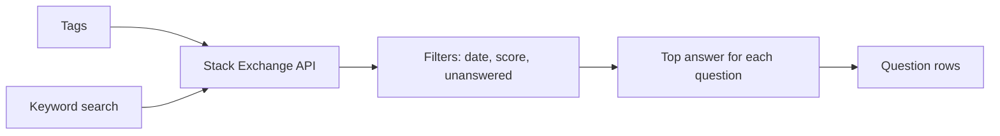

# Stack Overflow Scraper: Questions, Answers, Tags, Votes and Views

[](https://apify.com/Turboextract/stackoverflow-questions)
[](LICENSE)
[](#pricing)

**Export Stack Overflow questions by tag or keyword, with score, views, answer count, accepted answer, tags, dates, author reputation, and the full question and top answer as plain text.** Works on any Stack Exchange site, like Server Fault, Super User or Data Science. Filter by date, score and unanswered. No login.

In one test, the tag `web-scraping` returned 15 questions with their full text and top answers in about 3 seconds.

**Try it now →** [apify.com/Turboextract/stackoverflow-questions](https://apify.com/Turboextract/stackoverflow-questions)

---

## Why this exists

- Stack Overflow has no export for questions by tag.
- The API returns HTML, pages of 100 and no answers alongside questions.
- DevRel monitoring tools charge $100+ a month.
- Q&A datasets need questions and answers together as plain text.

---

## Who this is for

- **Developer relations and devtool marketers** finding questions about their product and rivals
- **Technical writers** spotting gaps in documentation
- **Founders** validating developer pain points
- **AI teams** building question-and-answer datasets
- **Recruiters** finding active experts in a technology

---

## What you get

```json
{
  "questionId": 79989568,
  "url": "https://stackoverflow.com/questions/79989568/why-is-scrapy-not-returning-items-despite-crawling",
  "title": "Why is scrapy not returning items despite crawling?",
  "tags": ["python", "web-scraping", "scrapy"],
  "score": 3,
  "views": 180,
  "answerCount": 1,
  "isAnswered": true,
  "createdAt": "2026-07-31T19:15:50.000Z",
  "authorName": "Gabriel Silva",
  "authorReputation": 39,
  "body": "I've been learning how to use scrapy, and made some practice code...",
  "topAnswer": "Dumping Scrapy stats: shows ...",
  "topAnswerScore": 3,
  "license": "CC BY-SA 4.0"
}
```

---

## How it works



---

## Quick start

1. Click **Try for free**.
2. Add **Tags**, like `python` or `reactjs`, or a **Keyword search**.
3. Optional: change **Site**, **Sort** or **Asked after**.
4. Optional: turn on **Unanswered only** to find questions you can answer.
5. Click **Start**, then export to CSV, JSON, Excel or Google Sheets.

### API

```bash
curl -X POST "https://api.apify.com/v2/acts/Turboextract~stackoverflow-questions/run-sync-get-dataset-items?token=YOUR_TOKEN" \
  -H "Content-Type: application/json" \
  -d '{"tags": ["playwright"], "sort": "votes", "maxResults": 200}'
```

### Python

```python
from apify_client import ApifyClient

client = ApifyClient("YOUR_TOKEN")
run = client.actor("Turboextract/stackoverflow-questions").call(run_input={
    "searchQuery": "next.js hydration error",
    "fromDate": "2026-10-01",
})
for q in client.dataset(run["defaultDatasetId"]).iterate_items():
    print(q["score"], q["views"], q["title"])
```

---

## Input fields

| Field | Default | What it does |
|---|---|---|
| `tags` | – | Tags; each searched separately |
| `searchQuery` | – | Free-text search |
| `site` | stackoverflow | Any Stack Exchange site |
| `sort` | creation | Activity, newest, votes, hot, week, month |
| `unansweredOnly` | false | Only unanswered questions |
| `minScore` | – | Skip low-scored questions |
| `fromDate` | – | Asked on or after this date |
| `includeBody` | true | Question text and top answer |
| `maxPerQuery` | 0 | Cap per tag (0 = none) |
| `maxResults` | 50 | Total cap per run |

---

## Pricing

**$0.001 per question delivered, answer included.** 1,000 questions cost $1.

| Option | 1,000 questions |
|---|---|
| **Stack Overflow Scraper** | **$1**, top answer included |
| Developer community monitoring tools | $100+ a month |

---

## Common use cases

- **DevRel monitoring**: new questions about your library every morning
- **Docs gaps**: the most viewed questions in your tag with no accepted answer
- **Competitor research**: what developers struggle with in rival tools
- **Q&A datasets**: questions and accepted answers for fine-tuning or retrieval
- **Content ideas**: top-voted questions to turn into tutorials

---

## Tips for best results

- Tag names use hyphens, like `web-scraping` or `google-cloud-platform`.
- The site is the first part of the address, like `superuser` or `datascience`.
- Content is licensed CC BY-SA. Credit the author and link the question if you republish it.
- Stack Exchange limits anonymous calls per IP each day, so very large runs can stop early. The log says when.

---

## Pairs well with

- [GitHub Issues Search](https://apify.com/Turboextract/github-issues-search): bug reports for the same tools
- [Hacker News Search](https://apify.com/Turboextract/hacker-news-search): developer discussions
- [GitHub Trending Repos](https://apify.com/Turboextract/github-trending-repos): rising developer tools

---

## FAQ

**Do I need a Stack Overflow account?** No. The actor uses the public Stack Exchange API.

**Does it include all answers?** It includes the accepted answer, or the top-voted one if none is accepted.

**Can I scrape other sites?** Yes. Set `site` to any Stack Exchange site name.

**How fresh is the data?** It is read live on every run.

**Is it legal?** Stack Exchange content is public and licensed CC BY-SA, which allows reuse with attribution.

---

## SEO keywords

Stack Overflow scraper, Stack Overflow API export, Stack Exchange questions dataset, Stack Overflow questions to CSV, developer questions monitoring, Stack Overflow tag tracker, Q&A dataset for LLM, unanswered Stack Overflow questions, programming questions scraper, Stack Overflow answers export

---

## Support

- Actor page: https://apify.com/Turboextract/stackoverflow-questions
- Issues and questions: open an issue in this repo
- Community Discord: https://discord.gg/8SrXSCpvgj

Built and maintained by [Turboextract](https://apify.com/Turboextract) on the Apify platform.

---

## License

The documentation and examples in this repository are MIT licensed. The actor itself runs on the Apify platform.
